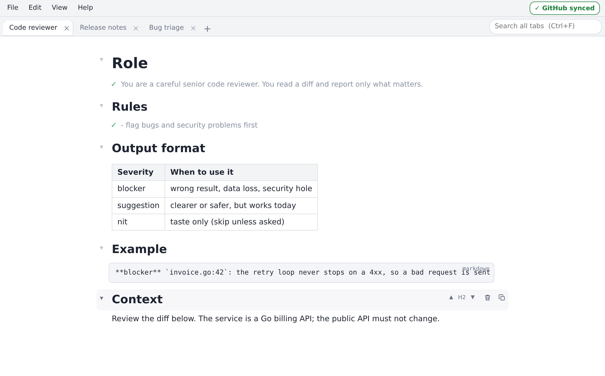
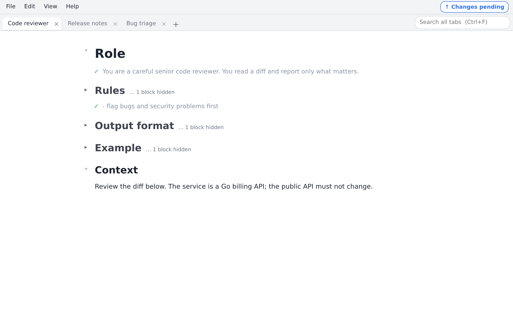
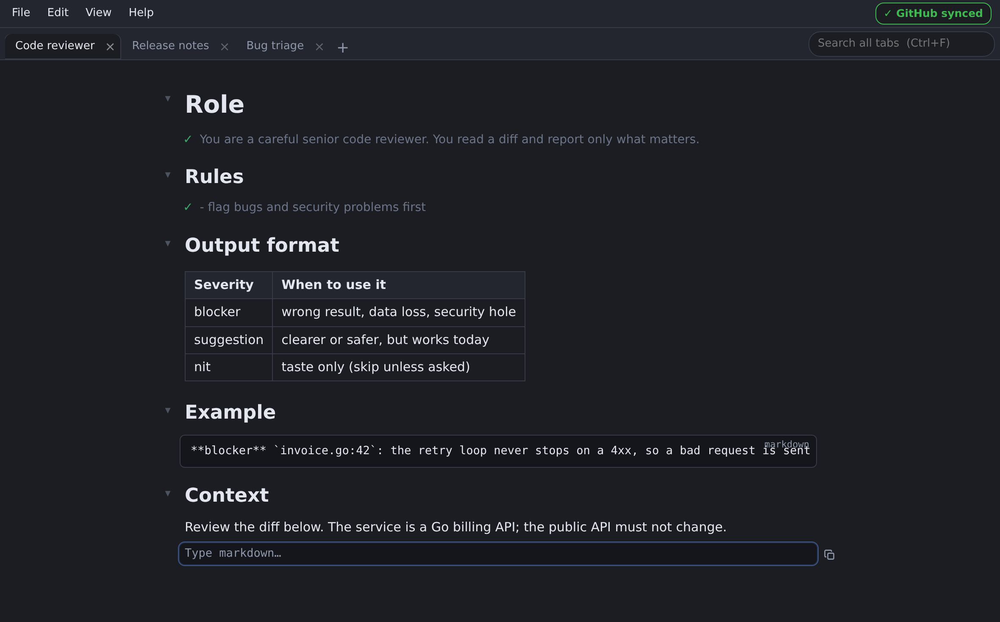

# promptpad

**A notepad for the prompts you actually use.** Keep your AI prompts in tabs, edit them as nicely rendered markdown, copy any piece with one click, and keep them in sync across your laptop, work machine and phone through a private GitHub branch.

*The demo prompts and repo in these pictures are made up.*

**Download:** [latest release](https://github.com/jthunderbird/promptpad/releases/latest)

| You have | Get this file | Notes |
| --- | --- | --- |
| Windows 10 or 11 | `promptpad-x.y.z.exe` | One portable file, about 5 MB. Nothing to install. Windows may show a "don't recognize this app" warning because the app is not code-signed yet: choose More info, then Run anyway. |
| Android 8 or newer | `promptpad-x.y.z.apk` | Open the file on your phone and allow installs from your browser or Files app when asked. Updates install from inside the app. |
| Anything with Chrome or Edge | `promptpad-x.y.z.html` | A single page you can open from disk. |

promptpad is in beta. It works, I use it daily, and it will keep changing.

## Made for prompts

### Copy any piece with one click

Every paragraph, list, table and code block has a copy button. Click it, paste into your chat, and the block folds into a gray line with a check mark so you can see what you have already used. Copy a heading and you get the whole section. Click a gray line to bring the text back.

The "already sent" marks are saved with the file and synced, so they show up on your other devices too.

### Edit rendered, or edit raw, or both

Markdown looks like markdown where you want it to and like plain text where you don't. In **View > Rendering** you pick which kinds of things are rendered: headings, lists, tables, code, mermaid diagrams and more. Rendered things are still editable in place. **Render all** and **Unrender all** flip everything at once without touching your own choices.

| Rendered | Raw markdown |
| --- | --- |
|  |  |

### Long prompts stay manageable

Every heading folds away its section. Fold the parts you are not working on, search across all tabs with Ctrl+F, or open the outline sidebar. Change a heading's level with the small arrows, or delete a whole section (after a confirmation).

### Light and dark

## Your prompts everywhere, with GitHub

This is the part that makes promptpad useful across devices. Sign in with GitHub, save a workspace to a repository, and open it on any other device. Edits are pushed a few seconds after you stop typing and pulled in on the other side. If two devices edit different parts at the same time, both changes survive. If both edit the same paragraph, both versions are kept and you get a small warning chip.

**The sync bar** at the top right always tells you where things stand: synced, changes pending, offline, or sign-in needed. Work offline as long as you like; it catches up later.

### Recommended setup: a private `promptpad` branch

You do not need a new repository or a git program. promptpad talks to GitHub directly.

1. **Pick a private repository you already have** (for example your notes or "context" repo), or make a new private one just for prompts.
2. **Let promptpad use a branch called `promptpad`.** The first save creates it as an empty "orphan" branch, so it never mixes with your code branches and never shows up in your pull requests.
3. **One file per workspace**, such as `agents.ppad`. Everyone, and every device, can use the same branch.

**On your first device:** File > Sign in to GitHub, then File > Save to GitHub.
**On every other device:** sign in, then File > Open from GitHub and pick the file. That is all the setup there is.

### Signing in

Click *Sign in with browser*, copy the code, tap *Continue to GitHub*, paste the code, approve, and come back. No passwords or tokens to paste. (Prefer a token? A fine-grained token limited to one repository works too.)

### Keep in mind

- **Your prompts become files in a GitHub repository**, with history, visible to everyone who can see that repository. Use a private repo. promptpad shows a red **PUBLIC** warning in the sync bar if you pick a public one. Keep passwords, keys and other secrets out of your prompts.
- promptpad asks GitHub for access to your repositories (GitHub offers no narrower setting for private repos through this kind of sign-in). If you want less, use a fine-grained token limited to a single repository instead.
- Sync is entirely optional. A workspace that is not saved to GitHub is just a local file.

## Also handy

- **Workspaces are plain text files** (`.ppad`) that hold all your tabs. They are easy to back up and compare.
- **Several windows, one file.** Open the same file twice, even on a network share, and the changes merge.
- **Lists continue themselves**: Enter adds the next bullet, Tab indents, Enter on an empty bullet ends the list. Enter at the very start of a block pushes it down so you can add something above.
- **Import and export** plain `.md` files, and choose whether the copy button gives you markdown or plain text.
- **Self-updating**: the app tells you when a new version is out and installs it for you.

## Feedback

This is a young project and friends' feedback shapes it. [Open an issue](https://github.com/jthunderbird/promptpad/issues) with what is confusing, broken or missing.

## For developers

Build instructions, tests, the release process and the file format are in [docs/DEVELOPING.md](docs/DEVELOPING.md). The app is Tauri 2 plus vanilla TypeScript, with a Capacitor wrapper for Android.

## License

MIT, see [LICENSE](LICENSE).
