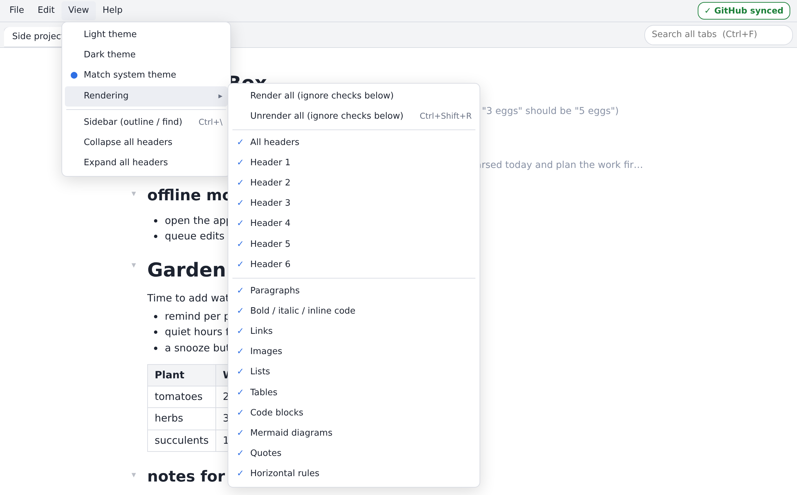
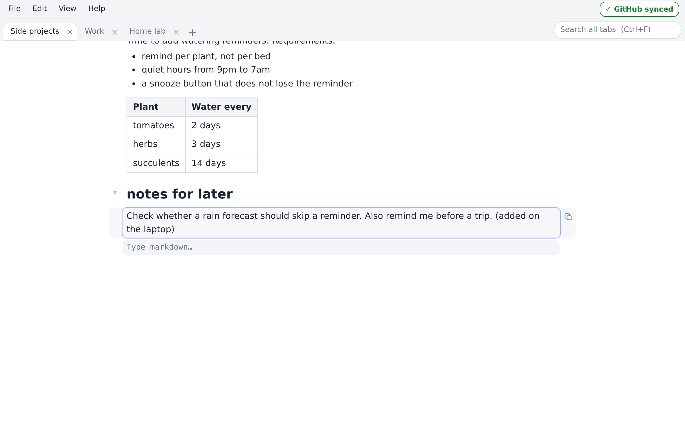
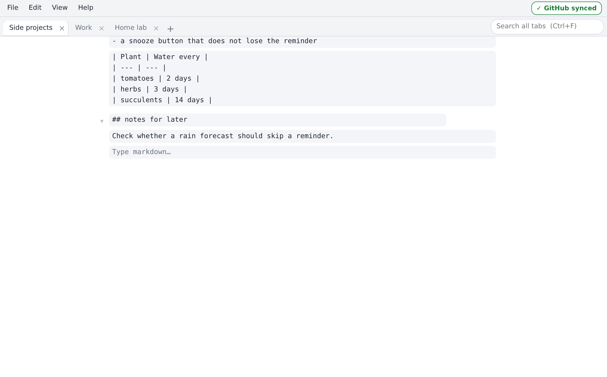
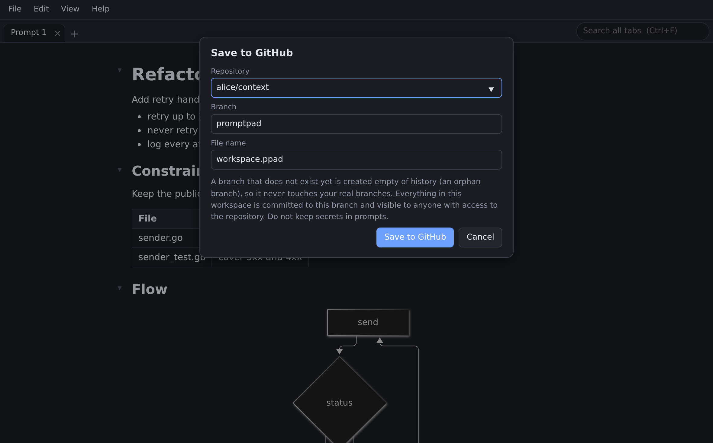
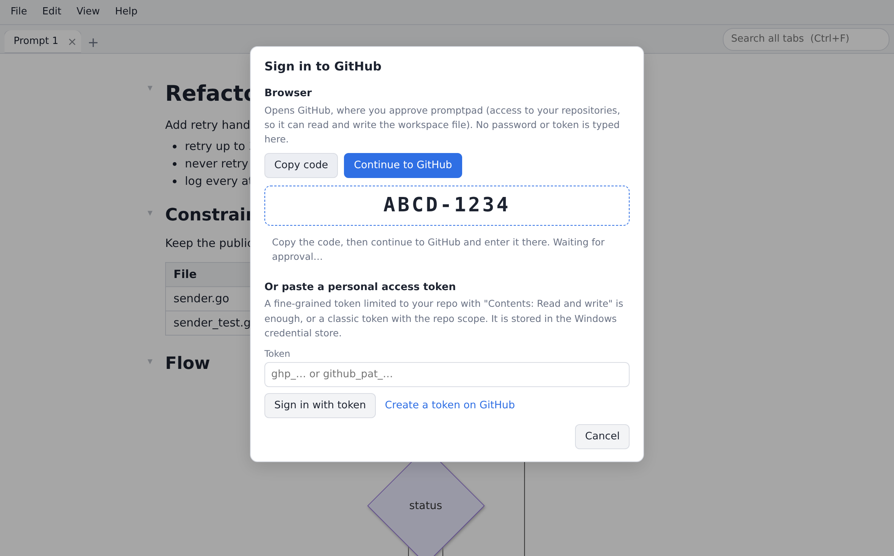
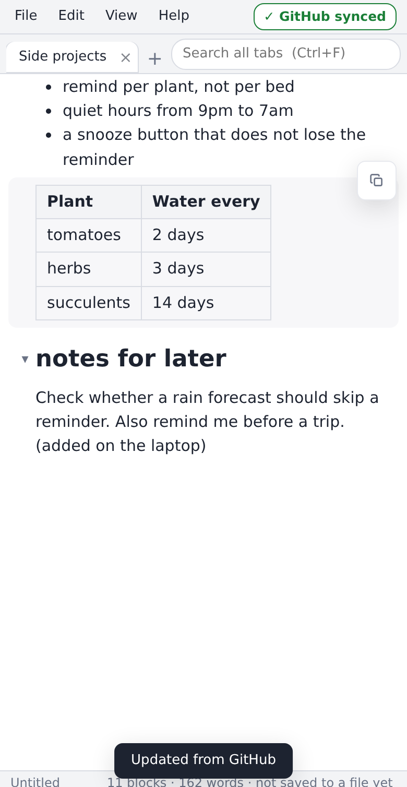

# promptpad

**Get your AI prompts ready before you send them.** promptpad is where the prompts you have not sent yet live: one tab per project (or group of projects), a block per task, editable until the moment you copy it into your AI chat. Then it keeps all of that in sync between your laptop, your work machine and your phone, through a private branch on your own GitHub.

*The projects, prompts and repo in these pictures are made up.*

**Download:** [latest release](https://github.com/jthunderbird/promptpad/releases/latest)

| You have | Get this file | Notes |
| --- | --- | --- |
| Windows 10 or 11 | `promptpad-x.y.z.exe` | One portable file, about 5 MB. Nothing to install. Windows may warn about an unrecognized app because the exe is not code-signed yet: choose More info, then Run anyway. |
| Android 8 or newer | `promptpad-x.y.z.apk` | Open the file on your phone and allow installs from your browser or Files app when asked. Later updates install from inside the app. |
| Anything with Chrome or Edge | `promptpad-x.y.z.html` | A single page you can open from disk. |

promptpad is in beta. It works, it is used daily, and it will keep changing.

## How people use it

You are working with an AI coding agent on several things at once, and ideas for the next prompt show up at odd moments: in the car, in a meeting, halfway through reviewing the last answer. promptpad is the place to catch them, polish them, and send them when they are ready.

- **A tab is a project, or a group of projects.** One tab for your side projects, one for work, one for the home lab.
- **A heading is a project or a topic** inside the tab: `# Recipe Box`, then `## import from a link`, `## offline mode`.
- **A block is one prompt (or one piece of one).** A block is just the text between blank lines, so a bullet list of requirements is a single prompt. Keep editing it as the idea sharpens.
- **When it is ready, click its copy button** and paste it into your agent. The block folds into a gray line with a check mark: sent. You can see at a glance what is still waiting and what has gone out. Click a gray line to bring the text back; click its x to remove it.

Copying a heading copies the whole section under it, so a project-level prompt is one click too.

The "sent" marks are saved in the file and synced, so a prompt you sent from your laptop is already gray on your phone.

### Editing that stays out of the way

Markdown looks like markdown where you want it and like plain text where you don't. **View > Rendering** chooses which kinds of things are rendered (headings, lists, tables, code, diagrams, and more), and rendered things stay editable in place. **Render all** and **Unrender all** flip everything at once without touching your own choices.

| Rendered | Raw markdown |
| --- | --- |
|  |  |

Every heading folds away its section, so you can hide the projects you are not thinking about today. Search across all tabs with Ctrl+F, or open the outline sidebar. Lists continue themselves (Enter adds the next bullet, Tab indents), and Enter at the very start of a block pushes it down so you can add something above it.

There is a dark theme too.

## Your prompts everywhere, with GitHub

Sign in with GitHub, save a workspace to a repository, and open it on any other device. Edits are pushed a few seconds after you stop typing and pulled in on the other side. If two devices edit different parts at the same time, both changes survive. If both edit the same paragraph, both versions are kept and a small warning chip tells you.

The **sync bar** at the top right always says where things stand: synced, changes pending, offline, or sign-in needed. Work offline as long as you like; it catches up later.

### Recommended setup: a private `promptpad` branch

No new repository and no git program needed; promptpad talks to GitHub directly.

1. **Pick a private repository you already use** (a notes or "context" repo works well) or make a new private one for prompts.
2. **Let promptpad use a branch called `promptpad`.** The first save creates it as an empty "orphan" branch, so it never mixes with your code and never appears in pull requests.
3. **One file per workspace**, for example `prompts.ppad`.

**First device:** File > Sign in to GitHub, then File > Save to GitHub.
**Every other device:** sign in, then File > Open from GitHub and pick the file. That is all the setup there is.

**Signing in** is one button: copy the code, tap *Continue to GitHub*, paste the code, approve, come back. No passwords or tokens to paste. (If you prefer, a fine-grained token limited to one repository also works.)

### On your phone

The Android app is the same promptpad, with the same GitHub sync, so the prompt you thought of on the couch is waiting in your editor at your desk.

1. Install the `.apk` from the releases page.
2. Sign in the same way (copy the code, continue to GitHub, paste, approve, come back).
3. File > Open from GitHub, and pick your file.

Edits are sent when you pause typing and again whenever you leave the app, so switching to your browser or locking the phone does not strand changes on the phone. Tap a block to show its copy and delete buttons. If you would rather keep a file on the phone alone, File > Open imports a copy of a `.ppad`, and File > Save as keeps one inside the app.

*(This picture is a phone-sized browser window, not a photo of a device.)*

### Working with a team

Several people can use the same file, and the merge is by block, so two people adding different prompts at the same time do not clobber each other. promptpad assumes what a good team does anyway: one person works on a given prompt at a time. So if you edit a prompt that someone else just sent (or the other way round), promptpad keeps both versions and shows a conflict chip instead of quietly picking one. That is on purpose: it means your workflow overlapped.

A few habits that work well:
- Share one branch (`promptpad`) in the team repo, and one `.ppad` file per team or per project group.
- Everyone signs in with their own GitHub account and needs write access to that repo.
- Give each person's work its own tab or heading.

**Who changed what.** Every push is a commit made by the person who edited, so GitHub's *History* and *Blame* views for the `.ppad` file on the `promptpad` branch show who wrote each line. **Blame inside promptpad itself (a small author mark on each block) is not built yet.** It is planned, not promised.

### Keep in mind

- **Your prompts become files in a GitHub repository**, with history, visible to everyone who can see that repository. Use a private repo. promptpad shows a red **PUBLIC** warning in the sync bar if you pick a public one. Keep passwords, keys and other secrets out of your prompts.
- Browser sign-in asks GitHub for access to your repositories (GitHub offers nothing narrower for private repos with this kind of sign-in). If you want less, use a fine-grained token limited to a single repository.
- Sync is optional. A workspace that is not saved to GitHub is just a local file.

## Also handy

- **A workspace is one plain text file** (`.ppad`) holding all your tabs. Easy to back up and compare.
- **Several windows, one file.** Open the same file twice, even on a network share, and the changes merge.
- **Import and export** plain `.md` files, and choose whether the copy button gives markdown or plain text.
- **Self-updating**: promptpad tells you when a new version is out and installs it for you.

## Feedback

This is a young project and feedback shapes it. [Open an issue](https://github.com/jthunderbird/promptpad/issues) with what is confusing, broken or missing.

## For developers

Build instructions, tests, the release process and the file format are in [docs/DEVELOPING.md](docs/DEVELOPING.md). The app is Tauri 2 plus vanilla TypeScript, with a Capacitor wrapper for Android.

## License

MIT, see [LICENSE](LICENSE).
